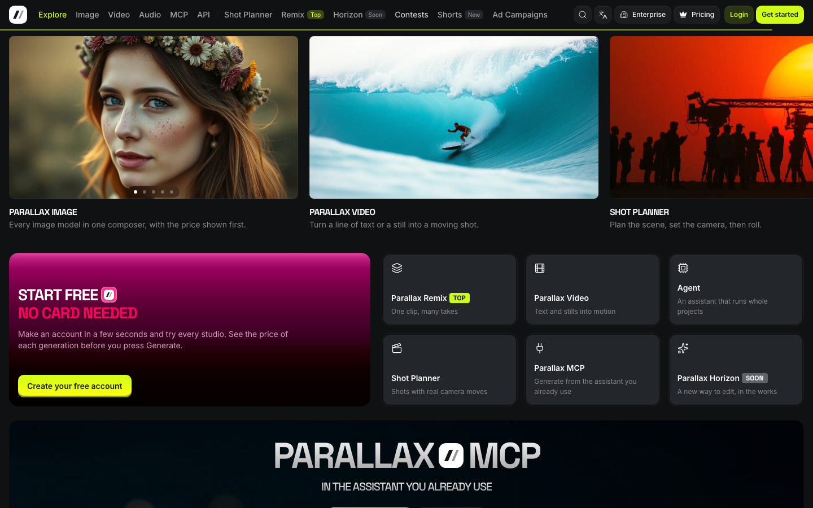
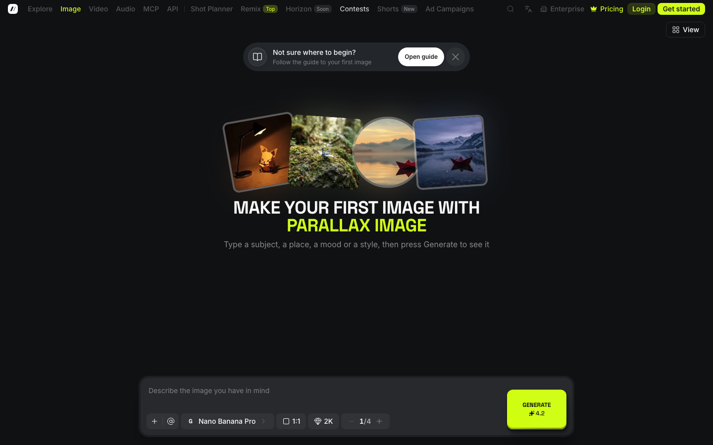
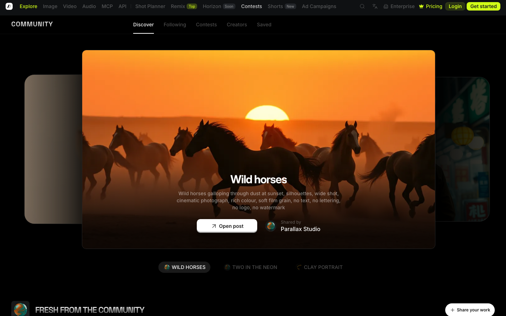
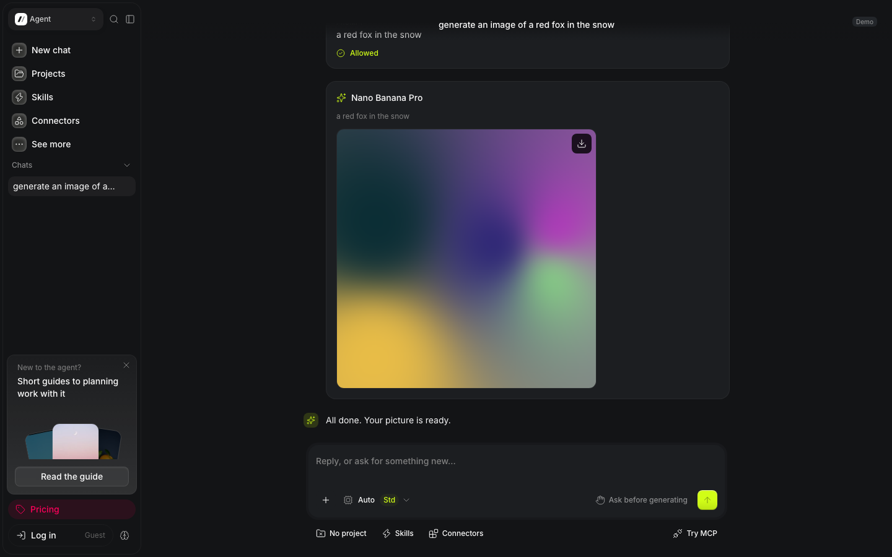

# Parallax

**An open-source AI image, video and audio studio, with an agent chat you can run on your own Hermes agent.**

One web app: studios for pictures, video, voices and music, tools built on top of them, a
community feed, a library, credits, an API for developers, and an agent that
plans and makes things for you.

> Parallax is an independent, unofficial, experimental project. Read the
> [Disclaimer](#disclaimer) before you deploy it or publish what it makes.



It runs with `npm run dev` and nothing else installed. The database is one SQLite file, and
without a provider key every model answers with a built-in sample file, so you can click
through the whole product for free.

| | |
|---|---|
|  |  |

## Quick start

You need Node.js 22.13 or newer (the app uses Node's built-in SQLite).

```bash
git clone https://github.com/nickvasilescu/parallax.git
cd parallax
npm ci
PARALLAX_DEMO_SEED=1 npm run dev
```

Open http://localhost:3000. You can try it as a guest with a few credits. Signing up keeps
what you made as a guest.

`PARALLAX_DEMO_SEED=1` fills a new install with four house accounts and about sixty published
pictures. They are AI-generated samples, and each post carries a prompt and a model id, so
Recreate works on all of them. Nobody can sign in as the demo accounts. Leave the variable
out for an empty feed.

## Real generations

Models are reached through one gateway, [treg.to](https://treg.to). Copy `.env.example` to
`.env.local` and set `TREG_TOKEN`. The app then runs in live mode: 39 image, video, voice and
music models, each with its own controls and an exact price shown before you press Generate.

`TREG_DAILY_BUDGET_USD` stops paid requests once that much was spent in 24 hours (default 5
dollars). Keep it low while you try things out.

## The agent chat, on Hermes and Orgo

The agent chat lives at `/agent`. It can run on three things:

| Engine | What answers | Needs |
|---|---|---|
| Stand-in (default) | A scripted assistant, so the screens work with no keys | Nothing |
| Built-in | Parallax runs the agent loop itself | `AGENT_MODE=live` and a model key |
| **Hermes** | Your own [Hermes](https://github.com/NousResearch/hermes-agent) agent runs the conversation | A Hermes agent, for example on an [Orgo](https://www.orgo.ai) computer |

With the Hermes engine, the agent does the thinking and Parallax gives it the studio's tools
over MCP. When the agent wants a picture, the member gets an approval card with the price and
pays with their own credits. The generation key never leaves Parallax.



*The chat above ran in mock mode: the scripted stand-in agent and a sample picture. On the
Hermes engine the same cards appear.*

**Set it up: [`docs/hermes-on-orgo.md`](docs/hermes-on-orgo.md).** It is a step-by-step guide:
turn on the agent's API server, make two secrets, join the machines, add one entry to the
agent's config, start Parallax. It also lists what to build next.

Three things to know before you start:

- The engine is tested end to end against a stand-in agent. It has not been run against a
  live Hermes agent yet. If you try it, please open an issue with what you found.
- The agent's own tools (shell, files, memory) are **not** behind Parallax's approval cards.
  Do not point a public Parallax at a personal agent. The guide explains the safe setup.
- A live agent (the Hermes engine, or `AGENT_MODE=live`) answers nobody until you list who may
  use it in `AGENT_ALLOWED_EMAILS`. Guests never can.

## What is in it

| Page | What it does |
|---|---|
| `/` and `/explore` | Home and the public feed |
| `/image`, `/video`, `/audio` | The three studios: pick a model, set its controls, generate |
| `/remix` | Restyle or move a picture or clip you already have |
| `/cinema` | Plan a film shot by shot and generate the shots as a batch |
| `/shorts` | Turn one idea into a short vertical video |
| `/apps` | One-purpose tools built on the models |
| `/ads` | Product ad campaigns with rounds and winners |
| `/canvas` | An open board for laying out pictures and notes (kept in the browser) |
| `/horizon` | A preview of what comes next: long-form video from one brief |
| `/guide` | How Parallax works: credits, studios and writing prompts |
| `/agent` | An agent chat that can use a cloud computer and connected apps |
| `/community`, `/u/<handle>`, `/contests` | Posts, profiles, likes, saves, comments, follows |
| `/library` | Everything you made or uploaded, with folders and favourites |
| `/pricing`, `/wallet`, `/settings`, `/notifications` | Plans, credits and your account |
| `/developer`, `/mcp` | API keys, webhooks, usage, and the MCP server for agents |

## What is not real yet

- **Payments.** There is no payment processor. The top-up button adds credits for free and
  says so. It is open by default only in mock mode; a live server keeps it closed unless
  `PARALLAX_DEMO_BILLING=on`. Never turn it on for a public server.
- **The agent's live mode.** `AGENT_MODE=live` can start cloud computers and connect
  outside apps, and both can cost money. It has had far less testing than the studios.
- **The Hermes engine against a real agent.** See above.
- **Boards** (`/canvas`) live in the browser only. **Horizon** is a preview page.
- **Offers.** There is an optional offer strip and discount badge (`promo` and
  `pricingBadge` in `src/content/site.ts`). Both are off by default and hold placeholder text.

Each page in `docs/api/` ends with an "Open improvements" list. Those are good first changes.

## Settings

Everything is optional. Put them in `.env.local`.

| Variable | What it does |
|---|---|
| `TREG_TOKEN` | The gateway key. Without it the app runs in mock mode |
| `TREG_MODE` | Force `mock` or `live` |
| `TREG_DAILY_BUDGET_USD` | Stop paid requests after this many dollars in 24 hours. Default `5`; a value that is not a number also means `5` |
| `PARALLAX_DATA_DIR` | Where the database and files live. Default `./data` |
| `PARALLAX_DEMO_SEED` | `1` adds the demo accounts and posts to a new data folder |
| `PARALLAX_GUESTS_PER_HOUR`, `PARALLAX_SIGNUPS_PER_HOUR` | Server-wide caps on new guest accounts (default 200) and sign-ups (default 100) per hour, since each starts with free credits |
| `PARALLAX_DEMO_BILLING` | `on` opens the free top-up button and free plan changes on a live server (they are open by default in mock mode only); `off` closes them everywhere |
| `PARALLAX_ORIGIN` | The public address of the app when it runs behind a proxy or a public link, for example `https://parallax.example.com`. The server writes its links with it and accepts requests from pages at that address |
| `COOKIE_SECURE` | `1` when serving over https |
| `AGENT_MODE` | `live` lets the agent use the three keys below. Every `AGENT_*` setting also reads its older `SUPER_*` name |
| `ANTHROPIC_API_KEY`, `ORGO_API_KEY`, `COMPOSIO_API_KEY` | The agent's model, its cloud computer, and its app connections |
| `AGENT_ENGINE` | `hermes` runs the agent chat on a Hermes agent instead of the built-in loop |
| `AGENT_ALLOWED_EMAILS` | Who may chat while the agent is live (a live service or the Hermes engine): emails, comma separated, or `*` for every signed-in member. Guests never. Unset means nobody |
| `HERMES_URL`, `HERMES_API_KEY_FILE`, `AGENT_ENGINE_TOKEN_FILE`, `AGENT_ENGINE_NAME` | Where the agent is, its key, the token it uses to call Parallax's tools, and the name members see |

## Run it for real

```bash
npm ci && npm run build
deploy/start.sh mock      # sample files. Drop "mock" for real generations.
deploy/stop.sh
```

`deploy/start.sh` runs the built app in the background with a clean environment and keeps its
data and log in `deploy/run/`. Read [`SECURITY.md`](SECURITY.md) before you put it on the
internet.

## Checks and tests

```bash
npm run typecheck
npm run lint
npm run check:registry     # every model, every combination of controls, has an exact price
npm run build
npm test
```

`npm test` starts the built app in mock mode on an empty data folder for each test file, and
removes every key from its environment, so a test can never spend money. The `.py` files test
the API (Python 3, standard library only). The `.mjs` files are browser walk-throughs; they
need Chrome and save their screenshots in `ui-shots/`. Set `UI_SIZE="390 844"` to walk through
at phone size. To run a few: `python3 tests/run.py tests/core_e2e.py tests/ui/home.mjs`.

## Where things are

| Path | What it is |
|---|---|
| `src/app/` | Pages and API routes |
| `src/server/` | Database, accounts, credits, jobs, the worker, files, the gateway |
| `src/registry/` | Every model: its controls, inputs, price and request |
| `src/components/`, `src/ui/`, `src/content/` | Screens, shared controls, and all wording |
| `migrations/` | The database tables, applied in order on first start |
| `seed/demo/` | The demo content |
| `docs/api/` | The API reference, one page per feature |
| `docs/hermes-on-orgo.md` | Running the agent chat on a Hermes agent |
| `docs/ui/README.md`, `CONTRIBUTING.md` | How to build a screen, and how to build a feature |
| `deploy/` | Scripts to run the built app in the background, and to join it to an agent |

## How this was built

Parallax was built in a day by a swarm of coding agents working from a written product spec
and a design system, each on its own cloud computer, with one orchestrator merging the work.
The API notes in `docs/api/` and the rules in `CONTRIBUTING.md` and `docs/ui/README.md` are
the same ones the agents worked from.

## Contributing

Read [`CONTRIBUTING.md`](CONTRIBUTING.md). Agents: read [`AGENTS.md`](AGENTS.md) first.

## Disclaimer

- **Independent and unofficial.** Parallax is an independent open-source project. It is not
  affiliated with, endorsed by or sponsored by any commercial AI studio, model provider or
  other company whose products or services it mentions or connects to. Model and provider
  names are trademarks of their respective owners and are used only to identify the models
  the app can call.
- **Original code and sample media.** The code in this repository was written for this
  project. The demo pictures and clips are AI-generated samples, included only to show the
  interface. If you believe a file here infringes your rights, report it privately (see
  [`SECURITY.md`](SECURITY.md)) and it will be reviewed and removed if needed.
- **Educational and experimental.** Parallax is provided "as is", without warranty of any
  kind, under the [MIT License](LICENSE). It has not been audited for production use.
- **Your responsibility.** If you run it, you are responsible for your own keys and the costs
  they run up; for what you and your users generate and publish; for following each model
  provider's terms and the law that applies to you, including rights of likeness, privacy and
  copyright in generated media; and for moderating any public instance.

## Licence

[MIT](LICENSE).
